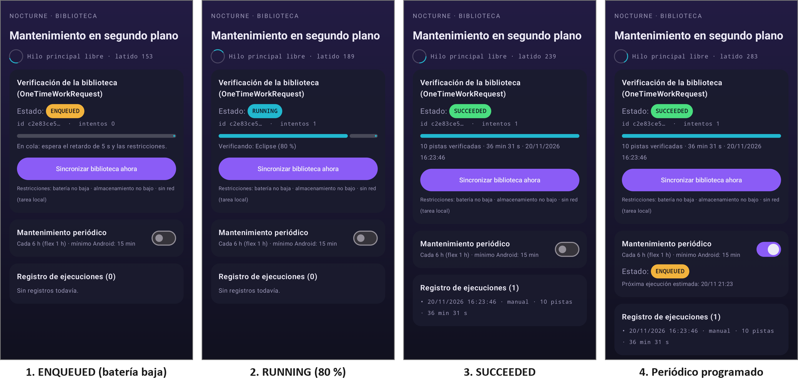

# Lab 10 · Tareas en segundo plano con WorkManager

Práctica 10 de *Introducción al Desarrollo de Nuevas Plataformas* (UNSA · 2026-B).
Añade al proyecto final del curso, el reproductor **Nocturne**, un **mantenimiento de la
biblioteca** que se ejecuta en segundo plano con **WorkManager**.

## Qué hace

- `MantenimientoBibliotecaWorker` (`CoroutineWorker` + `Dispatchers.IO`): recorre el catálogo,
  verifica cada pista, publica el avance con `setProgress`, guarda una línea con marca de tiempo
  en `registro_mantenimiento.txt` y deja mensajes en Logcat (etiqueta `NocturneWorker`).
- `ProgramadorMantenimiento`:
  - `OneTimeWorkRequest` con retardo de 5 s, backoff exponencial y `enqueueUniqueWork(REPLACE)`.
  - `PeriodicWorkRequest` cada 6 h (flex 1 h) con `enqueueUniquePeriodicWork(KEEP)`.
    El mínimo que permite Android es 15 min.
- `PantallaMantenimiento` (Compose): observa `WorkInfo` con `getWorkInfosForUniqueWorkFlow`
  y muestra estado, progreso, resultado y el registro.

## Restricciones

| Restricción | ¿Se aplica? | Motivo |
|---|---|---|
| Batería no baja | Sí | La tarea es prescindible y no debe gastar batería baja |
| Almacenamiento no bajo | Sí | El Worker escribe un registro |
| Red | No | La verificación es local |

Prueba: con `adb shell dumpsys battery unplug` y `adb shell dumpsys battery set level 8`, la tarea
queda en `ENQUEUED` (`Constraints not met`). Con `adb shell dumpsys battery reset`, empieza al
recibir `BATTERY_OKAY`. El Logcat completo está en [`docs/logcat_ejecucion.txt`](docs/logcat_ejecucion.txt).

## Hilo principal

El Worker se ejecuta en `DefaultDispatcher-worker-1`. `StrictMode` (en `MainActivity`) registra
los accesos a disco o red que se hagan en el hilo principal, y el contador «latido» de la pantalla
deja de avanzar si ese hilo se bloquea.

## Pruebas

`./gradlew connectedDebugAndroidTest`: 3 pruebas con `work-testing` (`TestListenableWorkerBuilder`,
`WorkManagerTestInitHelper` y `TestDriver`), todas exitosas en el emulador Pixel 7 (API 37).
